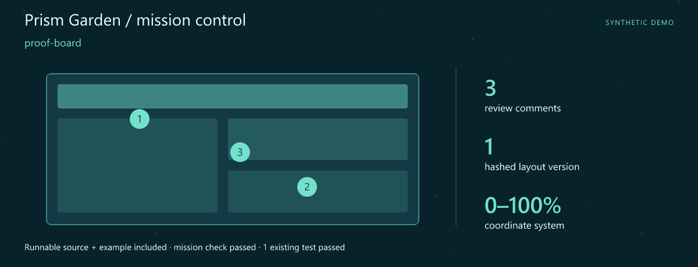
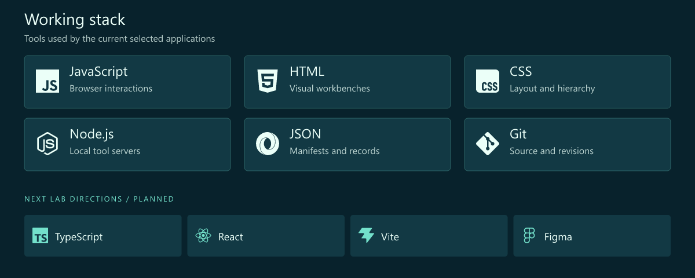
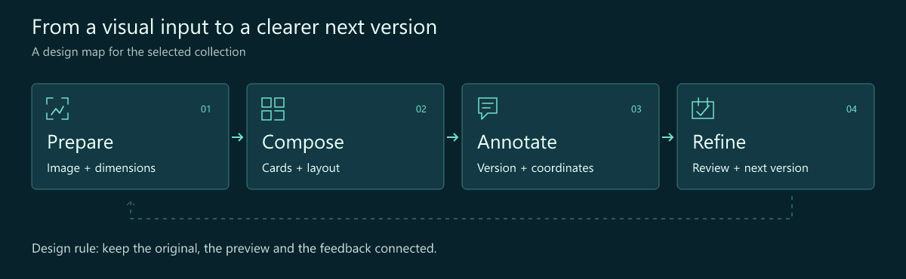
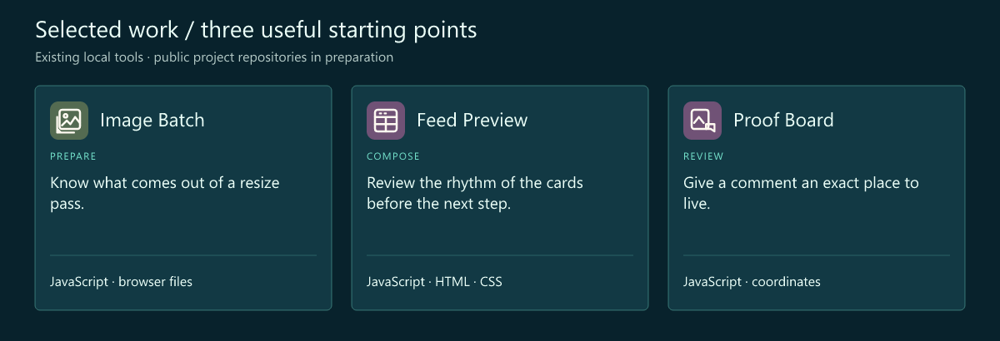

# Xiaoyu Lu · Interface Developer · Visual Browser Tools

> **Prism Garden** · Give every visual decision a place.

**Make the details easier to see, compare and discuss.**

[Download the runnable mission](src/assets/launch.zip) · [Launch guide](src/LAUNCH.md) · [Working stack](#working-stack) · [Selected work](#selected-work)

## Mission control



**First launch: proof-board.** A complete source snapshot, synthetic example and assertion script are included. The mission check and **1 existing test** passed. [Try the mission](src/LAUNCH.md) · [Snapshot and checked result](src/assets/launch.json).

I'm Xiaoyu Lu. This is a visual workbench for the moment before an export or a review: the crop, the rhythm of a card layout, the exact place a comment belongs.

The interface should make a visual decision easier to inspect. I like the path from a file to a preview, from a preview to feedback, and from feedback to a clearer next version.

## What I focus on

- **Image workflows.** Give export dimensions, source files and results an understandable place.
- **Interface composition.** Cards, spacing and hierarchy should support a quick visual review.
- **Feedback with context.** Keep a comment tied to its layout version and coordinates.

## Working stack



The upper panel shows technologies used by the selected tools. The lower row is the next lab track.

## How I think about the work



## Selected work

Three existing local tools form this curated collection. Their public project repositories are being prepared.



| Project / stack | Why it belongs here | Input → output |
| --- | --- | --- |
| **Image Batch**<br>JavaScript · browser files | Know what comes out of a resize pass. Resize selected images and inspect an export manifest. | **In:** Images + maximum dimensions<br>**Out:** Resized images + manifest |
| **Feed Preview**<br>JavaScript · HTML · CSS | Review the rhythm of the cards before the next step. Preview text-and-image cards locally with an adjustable column layout. | **In:** Card text + optional image<br>**Out:** A local card preview |
| **Proof Board**<br>JavaScript · coordinates | Give a comment an exact place to live. Keep layout versions and coordinate-based comments in one review workflow. | **In:** Layout version + comments<br>**Out:** A versioned feedback board |

### A review comment with a home

```csv
x,y,text
32,48,Check the heading alignment
68,72,Give this caption more room
```

Synthetic feedback entries: a position and an actionable observation are a useful starting point for visual review.

## Code and activity


These charts refresh from real GitHub observations on every successful workflow run, scheduled every six hours. At most one daily snapshot is committed; later runs still rebuild and publish the charts. Snapshot commits are labelled automated and authored by the profile owner using a verified GitHub noreply identity, with github-actions[bot] as committer. Owner contribution attribution follows GitHub rules; repository charts still include all authors. The observation time is printed on every chart. Commits are unique default-branch SHAs across all authors and owned public repositories, including forks. Language bytes describe repositories, not personal skill. Public interactions are a limited event feed (up to 300 events / 30 days), not visitor analytics. API and image caches may delay updates.

[Live data and scope](https://luxiaoyu99.github.io/luXiaoyu99/src/assets/live/metrics.json) · [Portfolio website](https://luxiaoyu99.github.io/luXiaoyu99/) · [Refresh setup](src/SETUP.md)

## Next lab

1. **Review each export.** Make image-by-image output inspection more comfortable.
2. **Arrange with less friction.** Explore easier card ordering and a typed layout model.
3. **Make feedback legible.** Refine annotation states and the path between layout versions.

## Start a conversation

A crop that needs context, a layout that is hard to compare or a review comment that gets lost is a useful interface problem to bring here.

[Open the profile repository's issues](https://github.com/luXiaoyu99/luXiaoyu99/issues) · [Browse the repositories](https://github.com/luXiaoyu99?tab=repositories)

> 🎨 Tuning the details.

---

<sub>Fictional developer persona · AI-illustrated avatar. Curated tools retain original authors, licenses and commit history. Technology icons: Simple Icons.</sub>

[Artwork and data notes](src/assets/NOTICE.md)
